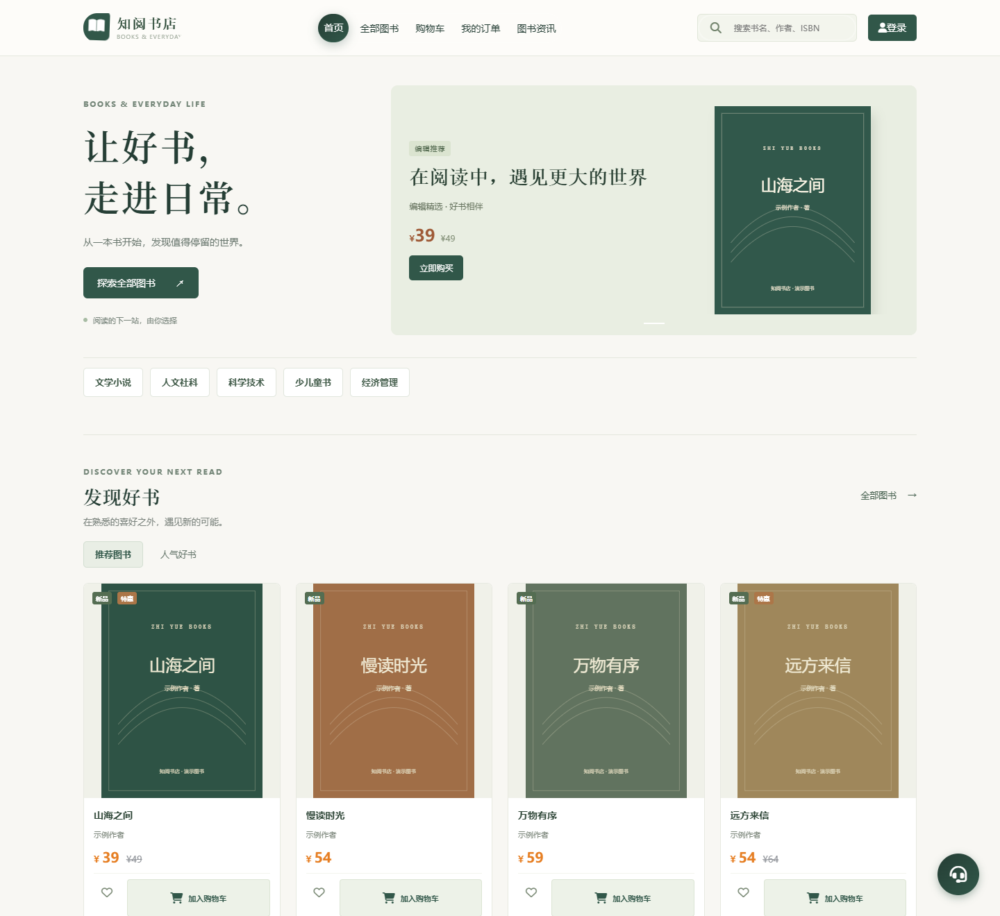
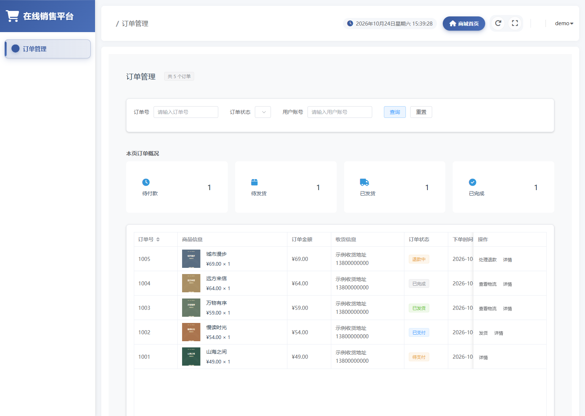
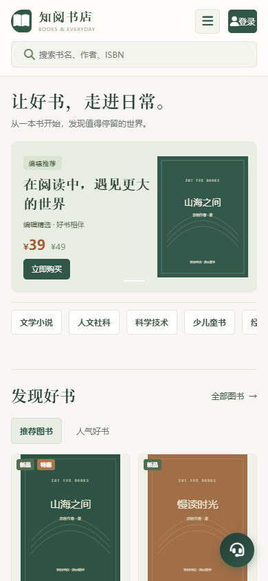
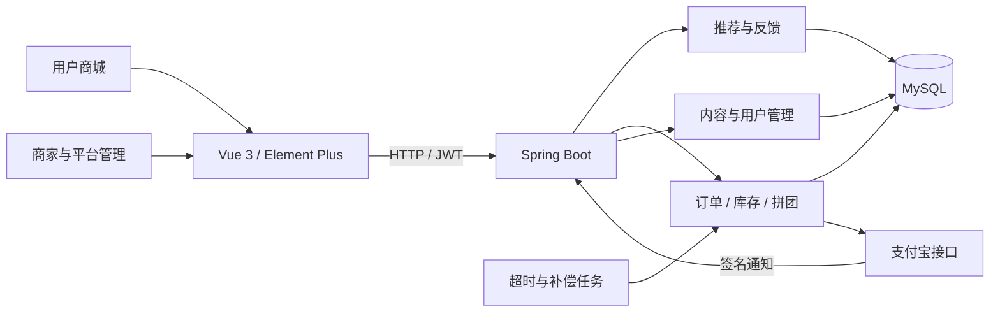

<div align="center">

# 知阅书店 · 个性化图书推荐与交易平台

让好书走进日常，也让每一笔交易有据可查。


[界面预览](#界面预览) · [技术亮点](#技术亮点) · [功能模块](#功能模块) · [本地运行](#本地运行) · [开发文档](#开发文档)

</div>

面向图书销售场景的前后端分离项目，包含**用户商城、商家管理和平台管理**。围绕个性化推荐、下单支付、拼团履约和退款补偿，实践权限校验、请求幂等、库存一致性及失败恢复。

## 界面预览

截图来自本项目实际前端，使用本地演示图书、账号与订单数据；封面为演示用排版，不代表真实出版物。截图未连接真实支付渠道，不包含真实用户信息。

### 商城首页

暖白与墨绿主题，展示编辑精选、图书分类、推荐书单与购物入口。



### 订单管理

管理端集中展示订单状态，按履约阶段提供发货、物流与退款操作。



<details>
<summary>查看手机端预览</summary>

<p align="center">
  
</p>

</details>

## 技术亮点

| 设计重点 | 实现方式 |
| --- | --- |
| 个性化推荐 | 基于已完成订单与收藏计算用户余弦相似度，结合候选排序、热门降级及反馈过滤，返回推荐理由；支持热门、内容与探索等推荐入口 |
| 下单幂等 | 普通下单、购物车结算与拼团下单接收 `Idempotency-Key`，按买家、入口和请求内容识别重试，相同内容返回原订单，内容冲突返回 409 |
| 库存预占 | 可选预占账本，在同一事务中扣减可售库存、记录预占并创建订单；付款消费预占，取消或超时释放，限制每用户有效预占额度 |
| 支付与退款补偿 | 支付通知验签并核验金额、状态；无法履约的收款进入持久化补偿，自动任务使用稳定退款请求号重试 |
| 权限与数据边界 | JWT 登录校验，按角色与资源归属限制操作；公开商品、商家和评价响应限制用户敏感字段 |
| 失败恢复与交互 | 提交防重复、失败后恢复表单；列表和统计区分加载失败与空数据，忽略晚到的旧响应，交易金额按订单快照展示 |

推荐模块中的部分算法得分仍为简化估算，未开展离线推荐效果评测；不将展示分数作为模型准确率。库存预占默认关闭，需审查迁移并统一配置后启用。

## 功能模块

| 角色 / 模块 | 主要能力 |
| --- | --- |
| 用户商城 | 邮箱验证码注册、登录、分类搜索、商品详情、收藏、购物车、收货地址 |
| 推荐中心 | 推荐理由展示、阅读偏好、喜欢 / 不感兴趣 / 已拥有等反馈 |
| 订单交易 | 普通下单、购物车结算、支付入口、取消、超时关闭、发货、签收、评价、退款 |
| 拼团 | 活动浏览、开团参团、成团后履约、失败补偿退款 |
| 商家与平台管理 | 按权限管理商品、订单、物流、库存出入库、用户与内容 |
| 内容与服务 | 图书资讯、公告、轮播展示、客服；AI 客服默认关闭，需另行配置 |

## 技术栈与架构

| 层次 | 技术 |
| --- | --- |
| 前端 | Vue 3、Vue Router、Element Plus、Axios、ECharts |
| 后端 | Java 17、Spring Boot 3.4.1、MyBatis Plus、Spring Security、JWT |
| 数据与基础设施 | MySQL 8；Redis 保留连接与诊断配置，业务查询暂未接入缓存 |
| 支付与验证 | 支付宝 SDK、JUnit 5、Mockito |



### 关键代码入口

- [推荐与反馈](springboot/src/main/java/org/example/springboot/service/RecommendService.java)：相似度、降级、排序及反馈处理。
- [下单幂等](springboot/src/main/java/org/example/springboot/service/CheckoutIdempotencyService.java)：请求标识与内容匹配。
- [库存预占](springboot/src/main/java/org/example/springboot/service/InventoryReservationService.java)：预占、消费、释放与额度检查。
- [支付处理](springboot/src/main/java/org/example/springboot/service/PaymentService.java) / [退款补偿](springboot/src/main/java/org/example/springboot/service/AutomaticRefundService.java)：交易状态与补偿流程。
- [回归测试](springboot/src/test/java/org/example/springboot)：权限、交易、库存与公开数据边界。

## 本地运行

需要 Java 17+、Maven 3.9.x、Node.js 22 / npm 与 MySQL 8。Redis 仅在验证连接诊断能力时另行准备。按 [开发与部署指南](docs/SETUP.md) 初始化**独立开发库**，并配置数据库、JWT 和邮件等本地参数。

```bash
git clone https://github.com/csyiiihh/recommender-ecommerce-platform.git
cd recommender-ecommerce-platform

# 终端一：后端，默认端口 1234
cd springboot
mvn spring-boot:run

# 终端二：从项目根目录启动前端
cd vue
npm ci
npm run serve
```

前端默认访问 `http://localhost:8080`，以终端实际端口为准。开发代理将 `/api` 与 `/alipay` 转发到后端。仓库只提供表结构，不提供商品数据、默认管理员密码、运行时图片或支付密钥；克隆后需自行初始化开发数据。支付可在浏览功能时留空，实际交易需配置渠道。

## 测试与验证

最近一次本地验证（2026-10-26）：后端 **344 项测试通过**并打包成功；前端静态检查、生产构建和仓库内 **22 个浏览器模拟场景通过**，覆盖路由、图片、公告净化、资讯排序及表单重复提交 / 网络失败重试。

```bash
# springboot 目录：测试并打包
mvn verify

# vue 目录：静态检查与构建
npm run lint -- --no-fix
npm run build

# 首次安装测试浏览器，然后执行模拟接口回归
npx playwright install chromium
npm run test:e2e
```

后端回归使用 JUnit / Mockito；浏览器回归使用 Playwright，静态资源和 API 均在浏览器内拦截，不连接业务后端。已提供 GitHub Actions 检查工作流，推送后需查看首次远程运行结果；本地通过不代表远程 CI 或真实 MySQL 并发、事务回滚、支付宝沙箱联调已通过。

## 开发文档

- [环境配置、数据库初始化、启动与部署](docs/SETUP.md)
- [交易补偿、库存预占与幂等边界](springboot/交易补偿与库存说明.md)
- [隔离验证与真实环境验收清单](springboot/隔离联调与验收清单.md)
- [资讯访问边界与冗余清理](docs/CLEANUP.md)
- [推荐一致性与查询边界](docs/RECOMMENDATION.md)
- [自动化检查与浏览器回归](docs/AUTOMATED_CHECKS.md)
- [独立环境联调执行手册](docs/INTEGRATION.md)
- [六步优化交付记录](docs/SIX_STEP_PROGRESS.md)
- [2026-10-26 审查修复与接口变更](docs/AUDIT_FIXES.md)

## 当前边界与后续计划

- 在独立测试库及支付宝沙箱中验证并发下单、库存回滚、重复通知和退款恢复。
- 补齐支付渠道侧截止时间与关单、独立支付退款流水及对账。
- 完善不可删除的库存审计记录、上传文件引用核对与清理、推荐效果评测。

仓库不包含真实凭据及业务数据。运行配置、上传文件、构建产物均不提交；详细使用边界见开发文档。
